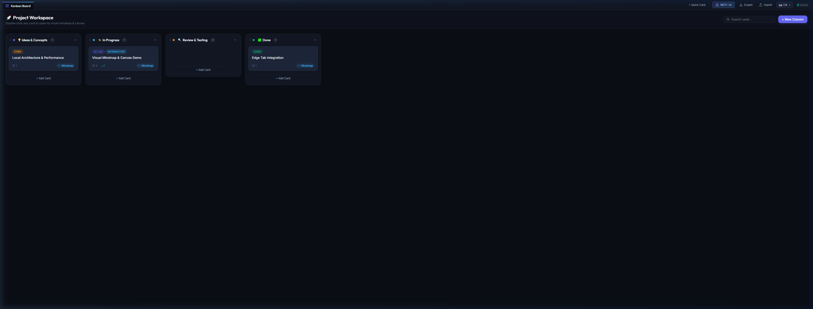
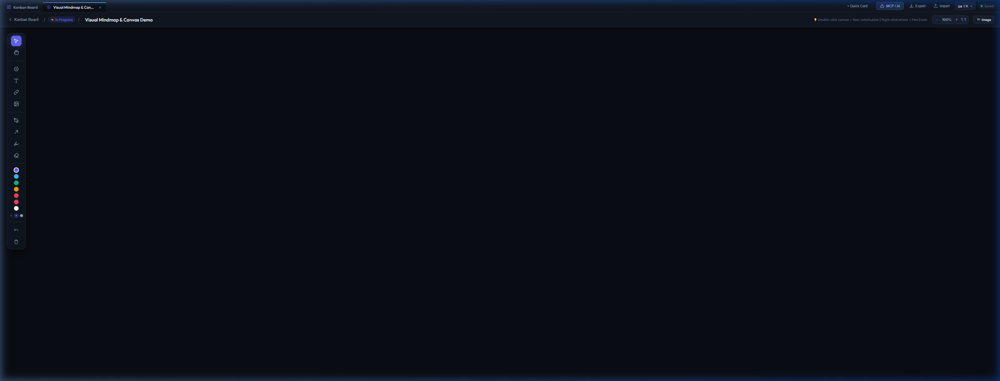

# Sunveil — Interactive Kanban & Visual Mindmap

> A local-first desktop workspace that brings together a Trello-like Kanban board, per-card visual mindmaps, a freehand drawing canvas, and a native Model Context Protocol (MCP) server for AI assistants.
> 
> 🤖 **Built with AI**: This entire project was created, designed, and coded collaboratively using AI agentic pair-programming (Google Antigravity).

---

## Screenshots

### 1. Kanban Board
*Interactive columns, drag & drop cards, live node/sketch indicators, and quick search.*


### 2. Visual Mindmap & Whiteboard Canvas
*Double-click any card to dive into its dedicated canvas with thought bubbles, curved connectors, web links, and freehand drawing tools.*


### 3. Model Context Protocol (MCP) & AI Integration
*Connect Claude Desktop, Antigravity, or Cursor to let AI assistants read, create, and organize your cards and mindmaps in real time.*


---

## Why Sunveil?

Most task managers are either simple checklists or heavy, bloated web apps. Sunveil gives you:
- **Instant local performance**: 0 npm dependencies, boots in milliseconds.
- **100% .EXE Free**: Runs through Node.js or PowerShell. No unsigned binary executables that trigger false-positive antivirus warnings or deletions.
- **Visual thinking per task**: Every task card has its own infinite canvas behind it. Double-click to brainstorm with bubbles, arrows, external links, and drawings.
- **AI-native**: Includes a full Model Context Protocol server (`mcp-server.js`) so AI tools can query your board or add ideas live on your screen.
- **Multi-language**: Built-in support for English (default), German, Spanish, and French.

---

## Quick Start

### Windows (One-Click)
Double-click `Start-Kanban.cmd`. It launches the app in a clean, standalone desktop window.

### Command Line (Cross-Platform: Windows, macOS, Linux)
```bash
# Clone the repository
git clone https://github.com/your-username/sunveil-kanban.git
cd sunveil-kanban

# Start
npm start
```
*(No `npm install` required — runs purely on the Node.js standard library).*

---

## Features

- **Kanban Board**: Drag-and-drop columns and cards, live card counts for notes & sketches, real-time search filter, and instant inline editing.
- **Visual Mindmap**: Double-click any card to open its private canvas. Connect nodes with clean curved lines that anchor to bubble borders.
- **Freehand Whiteboard**: Pen, arrow, highlighter, and eraser tools with custom colors and stroke widths. Export any canvas as PNG.
- **Edge-Style Tabs**: Keep the main board and multiple task mindmaps open side by side without losing state.
- **Auto-Sync & Local Storage**: Changes save instantly to `data/kanban_data.json` and `localStorage`.

---

## 🔒 Security & Local Isolation

The server runs locally on your machine and has been defensively hardened:
- **Strict Loopback Binding (`127.0.0.1`)**: Listens only on `127.0.0.1` on a dynamic port. Never binds to `0.0.0.0` or local network adapters (cannot be accessed from other devices on your Wi-Fi/LAN).
- **DNS Rebinding Protection**: Rejects requests with unexpected `Host` headers.
- **Cross-Site Request Blocking**: Prevents external websites visited in your everyday browser from making cross-origin requests (`Sec-Fetch-Site: cross-site`) to read or alter your boards.
- **Path Traversal Shield**: Canonical path resolution blocks `../` directory traversal and denies access to `.git`, `.env`, and session data.
- **Payload Limits**: 25 MB payload limit prevents memory exhaustion attacks.

---

## 🤖 MCP Setup (Claude Desktop & IDEs)

To let Claude Desktop or your IDE interact with your board, add the MCP server:

### Claude Desktop (`claude_desktop_config.json`)
```json
{
  "mcpServers": {
    "sunveil-kanban": {
      "command": "node",
      "args": ["<FULL_PATH_TO_PROJECT>/mcp-server.js"]
    }
  }
}
```

### Antigravity / Cursor (`mcp_config.json`)
```json
{
  "mcpServers": {
    "sunveil-kanban": {
      "command": "node",
      "args": ["<FULL_PATH_TO_PROJECT>/mcp-server.js"]
    }
  }
}
```

### Available MCP Tools:
| Tool | Description |
|------|-------------|
| `kanban_get_board` | Retrieve the complete board state (columns, cards, counters, tags). |
| `kanban_create_card` | Create a new task in any column. |
| `kanban_move_card` | Move a card between columns or reorder it. |
| `kanban_add_mindmap_node` | Add a thought bubble, link, or note to a card's mindmap. |
| `kanban_get_card` | Inspect detailed card info with all its bubbles and drawings. |
| `kanban_list_cards` | Search and filter cards by column or query. |
| `kanban_update_card` | Update title, notes, or tags. |
| `kanban_delete_card` | Delete a card by ID. |
| `kanban_list_columns` | List all columns with IDs, names, and colors. |
| `kanban_create_column` | Add a new phase column to the board. |

---

## Keyboard Shortcuts

- `Ctrl + S`: Quick save to disk & local storage
- `Escape`: Return to the main Kanban board
- `V`: Select & Move tool
- `H` or `Space`: Pan / Hand tool
- `P`: Pen drawing tool
- `A`: Arrow connector
- `E`: Eraser
- `B`: Add new thought bubble
- `Ctrl + Z`: Undo drawing stroke

---

## License

MIT License — see [LICENSE](LICENSE) for details. Free for personal and commercial use.
